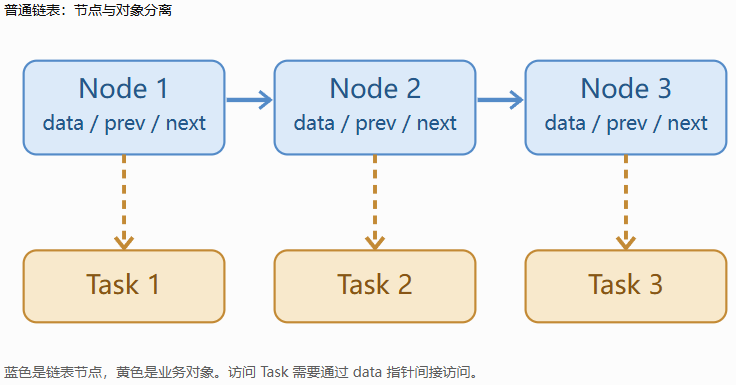
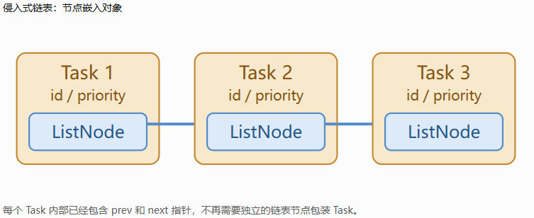
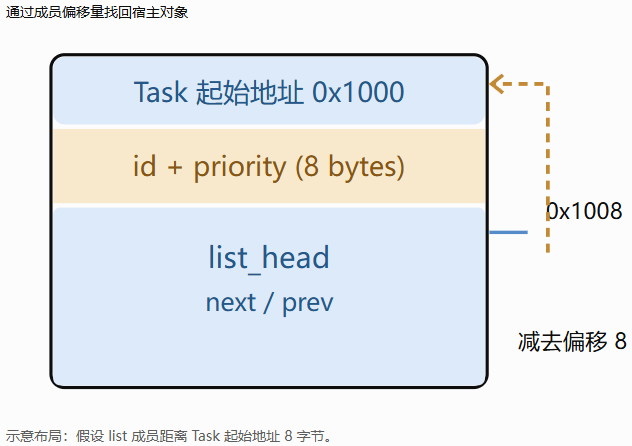
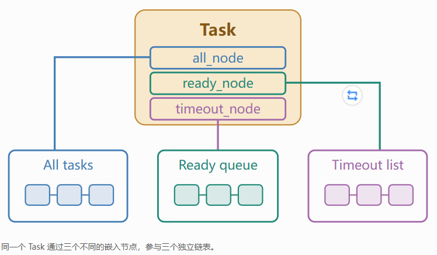

侵入式链表（Intrusive Linked List）是一种把链表节点直接嵌入业务对象内部的数据结构。

它和普通链表最大的区别是：

* 普通链表：链表节点是独立对象，节点通过指针指向业务数据。

* 侵入式链表：业务对象本身就包含链表节点，不需要额外创建一个节点来包装它。

侵入式链表广泛应用于 Linux 内核、操作系统调度器、内存管理器以及高性能网络框架。

我们从内存布局开始理解它为什么高效。

## 1. 普通链表和侵入式链表有什么区别？

假设我们需要管理一批任务，每个任务包含 `id` 和 `priority`。

### 普通链表

```
struct Task {
    int id;
    int priority;
};

struct Node {
    Task* data;
    Node* prev;
    Node* next;
};
```

内存结构大致如下：

普通链表：节点与对象分离



蓝色是链表节点，黄色是业务对象。访问 Task 需要通过 data 指针间接访问。

这种设计虽然通用，但会产生额外的节点对象。

### 侵入式链表

```
struct ListNode {
    ListNode* prev;
    ListNode* next;
};

struct Task {
    int id;
    int priority;
    ListNode node;
};
```

内存结构变成：

侵入式链表：节点嵌入对象



每个 Task 内部已经包含 prev 和 next 指针，不再需要独立的链表节点包装 Task。

这就是所谓的“侵入式”：容器的数据结构侵入了业务对象的定义。

## 2. 为什么侵入式链表效率更高？

主要有四个原因。

### ① 减少内存分配

普通链表在把一个已有 `Task` 放入链表时，往往需要：

```
Node* node = new Node;
node->data = task;
```

侵入式链表只需要：

```
list_insert(&task->node);
```

不需要为了插入链表单独调用 `new`。

在任务频繁加入和离开的场景中，减少内存分配通常非常有价值。

### ② 更好的缓存局部性

CPU 访问内存时，并不是每次都直接从主内存获取数据，而是会利用 CPU Cache。

普通链表中：

```
Node → Task
```

节点与对象可能位于不同的内存位置。

侵入式链表中：

```
Task {
    id
    priority
    node
}
```

节点和业务数据属于同一个对象，空间距离更近，通常更有利于缓存访问。

不过需要注意：侵入式链表并不保证整个链表连续存储。如果各个 `Task` 本身分散在堆内存中，遍历时仍然可能产生大量 Cache Miss。

### ③ 更少的内存开销

这里假设每个指针占 8 字节，不考虑额外的分配器开销和内存对齐差异。

对于 100 万个元素：

* 普通链表的节点字段约占 24 MB。

* 侵入式链表的节点字段约占 16 MB。

两者相差约 8 MB，而且普通链表可能还有额外的堆分配元数据和内存碎片。

需要说明，这并不意味着所有普通链表都比侵入式链表多 8 字节。例如 `std::list<Task>` 可以直接将 `Task` 存储在节点中，而不是再保存一个 `Task*`。

### ④ 已知节点时，插入和删除很直接

侵入式双向链表删除一个节点：

```c++
void remove(ListNode* node) {
    node->prev->next = node->next;
    node->next->prev = node->prev;
}
```

只修改几个指针，时间复杂度是 O(1)O(1)O(1)。

这里有一个容易误解的地方：

普通双向链表在已知节点位置时，同样可以做到 O(1)O(1)O(1) 删除。

侵入式链表的主要优势不是降低这个操作的渐进复杂度，而是减少额外分配、包装和部分指针间接访问的开销。

## 3. Linux 内核如何实现侵入式链表？

Linux 内核中的 `list_head` 是非常经典的侵入式链表设计。

简化后的定义类似：

```c
struct list_head {
    struct list_head *next;
    struct list_head *prev;
};

struct Task {
    int id;
    int priority;
    struct list_head list;
};
```

你可能会想到一个问题：

链表里只有 `list_head*`，它没有存放 `Task*`，我们怎么从节点找到完整的 `Task`？

答案是 `container_of`。

假设 `Task` 的内存布局是：

通过成员偏移量找回宿主对象



示意布局：假设 list 成员距离 Task 起始地址 8 字节。

对应的概念公式是：

Task 地址=list 地址−offsetof(Task,list)

一个简化的 C 写法：

C

```
#define container_of(ptr, type, member) \
    ((type *)((char *)(ptr) - offsetof(type, member)))
```

使用时：

C

```
struct list_head *pos = /* 链表节点 */;

struct Task *task =
    container_of(pos, struct Task, list);
```

这样就可以通过嵌入的链表节点，找回完整的业务对象。

这也是 Linux 内核侵入式数据结构设计的一个核心技巧。

## 4. 一个特别强大的能力：一个对象可以属于多个链表

假设操作系统中有一批任务，我们希望同时维护：

* 一个所有任务的链表。

* 一个等待执行的任务链表。

* 一个超时任务链表。

侵入式链表可以这样定义：

C++

```
struct Task {
    int id;
    int priority;

    ListNode all_node;
    ListNode ready_node;
    ListNode timeout_node;
};
```

一个任务对象可以通过不同的节点，同时加入三个链表。



同一个 Task 通过三个不同的嵌入节点，参与三个独立链表。

这很适合需要按不同维度组织对象的系统。

注意，每个 `ListNode` 通常在同一时间只能属于一个链表；要同时加入多个链表，必须使用不同的嵌入节点。

## 5. 侵入式链表有什么缺点？

它并非总是优于普通链表。

```
Task* task = new Task;

list_insert(&task->node);

delete task; // 危险！
```

如果没有先把 `task->node` 从链表中移除，链表就会保留指向已释放内存的指针，造成 Use-After-Free。

另外，移动或复制含有已链接节点的对象也可能破坏链表关系，因此这类对象通常需要限制移动和复制，或采取特殊处理。

## 6. 什么时候适合使用？

侵入式链表尤其适合以下场景：

* 操作系统内核：任务队列、设备对象管理、内存管理。

* 高性能网络服务：连接管理、超时队列、事件管理。

* 内存池和对象池：在已分配对象之间组织空闲链表。

* 嵌入式或实时系统：希望避免链表操作期间发生动态分配。

* 游戏引擎：管理大量频繁加入和退出集合的实体。

在 C++ 中，可以参考 Boost.Intrusive，它提供了侵入式链表、集合等容器的实现。

## 7. 最后总结

侵入式链表的高性能本质，可以归纳成一个思路：

把管理对象所需要的数据结构，提前放进对象自身，用对象布局上的约束，换取运行时的效率。

它不改变双向链表插入和删除的 O(1)O(1)O(1) 时间复杂度，但可以：

1. 避免单独为链表节点分配内存。

2. 减少额外的指针和部分间接访问。

3. 改善节点与宿主对象之间的缓存局部性。

4. 让一个对象通过多个嵌入节点参与不同链表。
