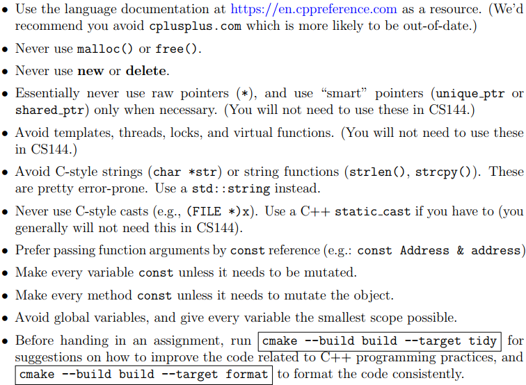
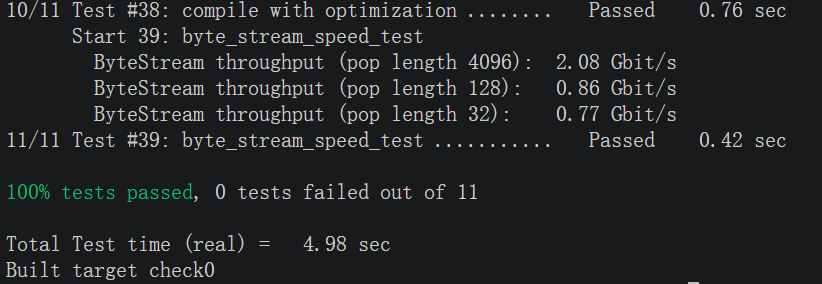

## 序言

最近在网上搜索优质的C++项目，但是网络上的各种推荐要么是直接用AI生成的，要么就是被各种培训机构的铺天盖地宣传所充斥。最后考量下来还是觉得学些国外优质课程的lab比较适合自己。不仅文档齐全，而且代码质量上乘，大多数项目都提供了齐备的自动化测试工具，对于我来说可以是能接触项目中的精品了。

CS144是计算网络课程，配套实验是引导学生使用C++搭建TCP/IP协议栈，同时又被推荐为“可能是年轻人最好的现代 C++ 入门课”。这非常符合自身的情况，之学习过C++理论知识，缺少项目的实践。做一个既能锻炼编码能力，又能增强对计算机网络通信的理解能力，何乐而不为呢？

## 实验资源 & 实验环境

cs144的资源分为早期的sponge和现在的minow版本，但是官方只会保留现年份的代码仓库，所以这里我选择的是Fall 2026

​	课程主页：[CS 144: Introduction to Computer Networking](https://cs144.github.io/)

​	官方代码仓库：https://github.com/CS144/imp

我自己使用的虚拟机上版本较老，但因为还有其他资源，所以只是更新了所使用的工具链而非更新OS版本。

​	虚拟机：VMware Workstation + Ubuntu 22.04.5 LTS 64位

​	设备资源：2核4G内存+20G存储空间

​	开发环境：gcc13 + VScode + ssh连接本地虚拟机

官方命令禁止将代码开源，所以不会给出自己的代码仓库，本文章用作自己记录学习实践过程，分享踩坑经历和学习反思。

## Check0

第一个实验主要是感受网络通信，从高层角度的实际体验一次网络通信的形式。

我觉得所给出C++编码建议非常棒，值得反复阅读记忆，并且其应用到日常编码中.

### webget

使用所给出的接口实现从网站获得所有信息的功能。这里其实是让我做的比较难受，因为文档这里对于功能描述就一句话

> It’s time to implement webget, a program to fetch Web pages over the Internet using the operating system’s TCP support and stream-socket abstraction—just like you did by hand earlier in this lab.  

这里想来其实就是按照之前使用telnet通信的过程依葫芦画瓢就行，但是自己第一次做lab，对于国外的lab文档风格不太了解，就看的比较懵逼。

### An in-memory reliable byte stream  

所要求实现的功能有点像OS里的pipe，就是单线程读写者问题，需要考虑到互斥性。

这里比较有意思的是：测试程序的会对程序的性能进行评估，低于0.1Gbit/s都会被斩杀，而作者在设计接口的时，又别有用心的将读者端的读操作拆分为了peek和pop，根据需要实现的功能来看，应该是先使用peek来只看、不消费，pop端只做消费。

**这里应该尽可能的避免数据拷贝和移动**，应该考虑设计一个合理的数据结构或者是优化pop() & push()逻辑。

### 实验结果

最后附上实验结果：

实验文档说速度最高可以到10Gbit，还是有点好奇的233~

