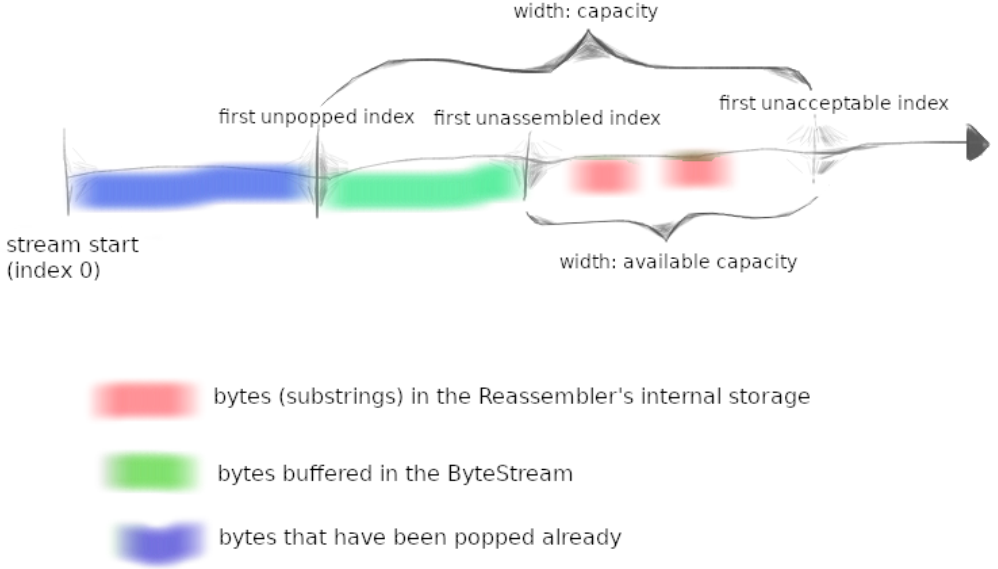
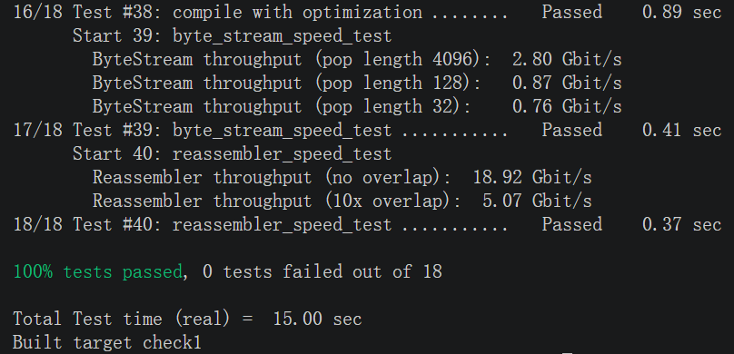

## 实验任务

本章节的实验需要在check0的基础之上完成一个字符串重组器：

> In this checkpoint you’ll create the module responsible for this reassembly: a Reassembler. It will receive substrings, consisting of a string of bytes, and the index of the first byte of that string within the larger stream. Each byte of the stream has its own unique index, starting from zero and counting upwards. As soon as the Reassembler knows the next byte of the stream, it will write it to the Writer side of a ByteStream— the same ByteStream you implemented in checkpoint 0. The Reassembler’s “customer” can read from the Reader side.  

关于重组器的具体要求见实验文档的3.1，他详细描述了重组器内部的功能要求。

但是在实现的时候仍然要考虑到许多工程实践的问题，好在本次实验提供了许多的测试样例 `(imp/tests/reassembler-*.cc)` 可以辅助检查自己的功能是否正确。

实验文档中给出了整个字节流的划分，对应了的不同组件。这张图不仅可以建立起宏观的清晰认识，还对于实现重组器过程有很好的指导。



## 实现思路

### 数据结构设计

我使用了一个定长滑动窗口来作为重组器的缓存以来接收那些暂时还不能push的字节流。为了保证收发数据的一致性，避免遗漏数据（如`'\0'`）情况发生，需要维护一个状态以来区分那些存储和未存储数据的区域，这里我选择了位图的思想来保存缓存中每一个字节的状态。

因为字节流是有可能无限长的，而每一次接收到信息只有字串和字串第一位在整个字节流中的索引，而自己的滑动窗口又是定长，所以这里维护了  `reassembler_start_` 和 `reassembler_end_` 变量以来便于完成字节流字串和缓存中的位置偏移转换。

最后会收到`is_last_substring`的标志，在完成发送后需要关闭连接。

```c++
  std::string cache_{};
  uint64_t reassembler_start_ = 0;  
  uint64_t reassembler_end_ = 0;    
  uint64_t reassembler_capacity_ = 0;
  uint64_t stream_end = 0;
  std::vector<bool> state_map_{};
  bool last_flag = false;

  ByteStream output_;
```


### 处理流程

`insert` 函数要实现的功能描述很具体了

> 1. Bytes that are the next bytes in the stream. The Reassembler should push these tothe stream (output .writer()) as soon as they are known.
>
> 2. Bytes that fit within the stream’s available capacity but can’t yet be written, becauseearlier bytes remain unknown. These should be stored internally in the Reassembler.
> 3. Bytes that lie beyond the stream’s available capacity. These should be discarded. TheReassembler’s will not store any bytes that can’t be pushed to the ByteStream eitherimmediately, or as soon as earlier bytes become known.

字串(data)和重组器(reassembler)的位置关系组合非常多，函数实现的关键是对不同关系的正确处理。

1. 拒绝接收：data位置在reassembler的两侧，且不产生贴合或者重叠的可以直接拒绝接收

2. 接收：data有可能全部在reassembler内部，又或者一部分在reassembler内部。这里我引入了 `check_and_update` 函数，专门负责处理将接收的data正确的放入重组器缓存中并且更新状态

倘若重组器内部的缓存从 `reassembler_start_` 开始的地方有数据了，那就要将其压入，并且移动窗口。有可能出现这种情况的地方有两处：一个是data在前，reassembler在后且产生重叠的情况，一个是data的开始刚和和reassembler的开始下标吻合。

最后如果接收到了最后一个字串，得到整个字节流中的最后一位，那么当reassembler_start_也移动到这个位置的时候就可以关闭连接了。

`count_bytes_pending`过一遍缓存，检查状态即可


## 尝试过的方法以及遇到的困难

我最开始的思路是将发送进来的data组成一个struct block，其中包含数据，在字节流中的开始和结束位置。然后使用list把所有临时存储的data串起来组成重组器中的缓存。insert函数中暂存就是寻找区间合并，然后更新block即可。但是当我面对无数的边界情况时写出了满屏的if-else，这样子不仅阅读和debug非常困难，而且因为位置关系很多且下标的语义不同，我需要处理的合并问题比想象中要复杂的多，所以抛弃了这种设计。

当前的设计在设计的时候也遇到过一些问题，我最早没有设计状态位图，当发送空洞`\0`的时候就过不了测试点。

此外因为设计变量的语义和文档所给出的一些下标语义对齐的不是很明确，所以下标问题调试了非常久。

还有一个很重要的漏洞我没有考虑到，我的滑动窗口每当移动的时候，我不仅需要改变开始结束的标志，还要移动内部的数据，我最早是没有考量的，在测试中才发现了这个问题。


## 总结

本次实验中，我走了很多弯路，踩了非常多的坑。在看完文档后我就立刻开始着手编程，虽然比较兴奋但是并没有真正的想清楚应该怎么写，这就导致了后来抛弃第一种设计以及花费了大量的时间调试，也反映出了我的工程经验非常匮乏。我认为一种在编码前经过充分的思考设计是最能节约开发时间的行为，而思考设计需要尽可能的列出所有实现思路并且能提前预判实现难点在哪里，有什么坑。在衡量比较后，才能选择一种“性价比”最高的实现。这种能力不仅需要对相关技术非常熟悉而且要有大量的经验积累。

虽然花费了许多时间，但是当100% test passed出现的一下还是非常激动的~~




