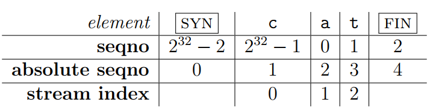

## 实验任务

> you’ll implement the “receiver” part of TCP, responsible for receiving messages from the sender, reassembling the byte stream (including its ending, when that occurs), and determining that messages that should be sent back to the sender for acknowledgment and flow control  

在重组器的基础之上实现TCP可靠传输的接收端。check2将任务拆成了两个子任务，首先会实现一个专门用于管理字节序列号的Class-Wrap32,接着会使用这个类型来实现接收端的具体功能-接收数据并返回给发送端必要的信息.

## 实现思路

### Wrap32

在TCP的设计中，序列号seqno的被设置为了32位，但是这只能表示4Gb的数据，在当下的背景下显然是不满足使用的，而64位的存储是近乎无限大的，所以我们需要一种将方法能正确“翻译”TCP报文中的seqno，而使得在整个字节流中的位置不出错。在这样的需求下就产生了Wrap32类可以实现绝对位置和seqno的相互抓换。具体的对应表如下




该类需要实现两个函数

```c++
Wrap32 Wrap32::wrap( uint64_t n, Wrap32 zero_point )
uint64_t Wrap32::unwrap( Wrap32 zero_point, uint64_t checkpoint ) const
```

第一个函数非常简单，考虑到 `uint32_t` 在发生上溢后，会回绕到0。完美符合函数需求，所以直接将参数相加返回即可

而第二个参数就比较复杂了，我自己的实现方法不是特别优雅(laji)：

因为是无符号整型，所以将计算机的数据表示范围可以看作一个时钟，当发生溢出其实就是进行了回绕，而将seqno翻译为绝对位置时要考虑到通过checkpoint来确定真正的大小，因为不同结果之间相差 ` n*(1ull<<32)` .

我首先想到的是直接暴力循环：每次累加一个2^32，当其与checkpoint的差值变大的时候，那么就是所需要的数。但是这种方法最差需要累加 2^32 次，时间复杂度过大

然后就是相当使用checkpoint / 2^32,得到一个大概的区间倍数，缩小区间后再分类讨论情况确定，这种算法的弊端就是代码编写复杂且不易阅读。

最后应该是存在一种高效的算法，是代码量再10行以内，可以参考：[CS144（2024 Winter）Lab Checkpoint 2: the TCP receiver_cs144 lab2-CSDN博客](https://blog.csdn.net/Kovnt/article/details/135793894)

本章的实验难点应该就是这个了。


### receiver

有了wrap32的功能支撑后，实现receiver就非常简单了，只需要对照接口实现即可，只有一个坑需要注意。

带有SYN的TCP报文是有jisuan可能携带数据和FIN，而SYN是需要小号一个seqno，这就会导致一个问题：假如第一个报文有SYN但不携带数据，第二个报文才会有数据，那么计算重组器插入的data的首个位置时，有可能因为SYN占用一个seqno而导致计算错误，进而使得数据全部停留在了重组器的缓存中而不压入ByteStream

我的解决方法就是针对SYN特判，如果是上述情况，那以后计算时都要减去一。

## 总结

 实验只能说是通过了正确性检测，但是代码的简洁性，可读性等确实不好，归根到底还是我的能力不够，继续加油吧 ^ _ ^

